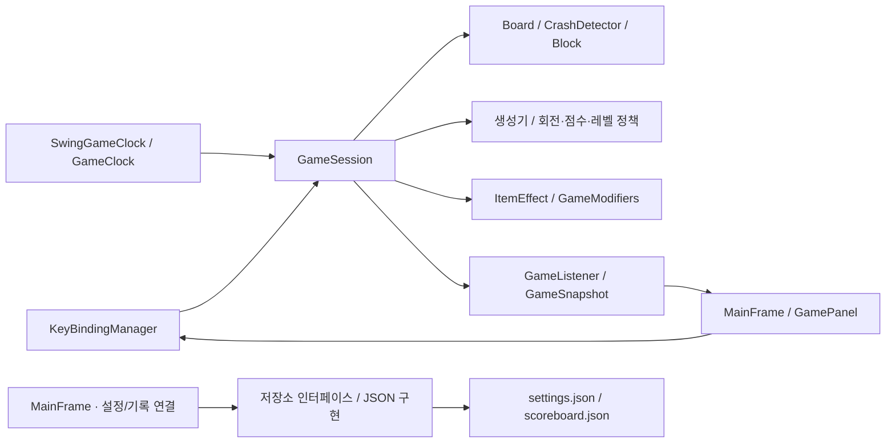

# SE Tetris · Team 6

Java 21과 Swing으로 구현한 테트리스입니다. 일반 모드의 난이도 3종과 아이템 모드, 키 설정, 분류별 스코어보드, Windows 실행 패키지를 제공합니다.

**[Windows ZIP 바로 다운로드](https://github.com/yoobinkim541/SE_tetris_team6/releases/download/v0.4.0-rc.3/SE-Tetris-windows.zip)** · **[실행 JAR 다운로드](https://github.com/yoobinkim541/SE_tetris_team6/releases/download/v0.4.0-rc.3/SE-Tetris.jar)** · **[릴리스 보기](https://github.com/yoobinkim541/SE_tetris_team6/releases/tag/v0.4.0-rc.3)** · [전체 릴리스](https://github.com/yoobinkim541/SE_tetris_team6/releases)

현재 다운로드 버전은 **v0.4.0-rc.3 (사전 릴리스)** 입니다. 위 링크는 해당 버전의 고정 다운로드 링크입니다. 구현·자동 검증과 별도로 실제 사용자 평가 및 교수자 확인은 남아 있습니다.

## 다운로드하고 실행하기

1. Windows ZIP을 다운로드하고 압축을 모두 해제합니다.
2. `SE Tetris/SE Tetris.exe`를 더블클릭합니다. Java 런타임과 아이콘이 포함되어 별도 Java 설치가 필요 없습니다.
3. 메인 메뉴에서 일반 모드 또는 아이템 모드를 선택합니다. 일반 모드 난이도는 설정에서 변경합니다.

JAR은 Java 21 이상에서 다음과 같이 실행합니다.

```powershell
java -jar SE-Tetris.jar
```

## 주요 기능

| 기능 | 동작 |
|---|---|
| 기본 게임 | 20행 × 10열 보드, 7종 블록, 이동·회전·Soft/Hard Drop, Next 미리보기 |
| 일반 모드 | Easy / Normal / Hard에 따라 I 블록 가중치와 레벨별 낙하 속도 증가폭 조절 |
| 아이템 모드 | Normal 고정, 누적 삭제 줄 수가 10줄 경계를 넘으면 새 Next에 아이템 예약 |
| 삭제 연출 | 삭제 대상을 150ms 동안 표시한 뒤 삭제·점수·카운터·다음 Spawn 처리 |
| 세션 제어 | Pause / Resume / Restart / Quit 확인, 포커스 이탈 시 일시정지 |
| 접근성·설정 | 화면 크기 3종, 색맹 모드, 조작키 변경·중복/예약키 검증, 기본값 복원 |
| 스코어보드 | 일반 Easy / Normal / Hard와 아이템의 4분류별 Top 10, 좌우 탐색·새 기록 강조 |
| 저장 | 설정·난이도·기록 JSON 저장, 이전 파일 형식 호환과 잘못된 데이터 처리 |
| 아이템 표시 | 현재·Next 아이템 문자, 고정 D/S 문자 유지, x2·SLOW 잔여 블록과 게이지 |

### 아이템 5종

| 표시 | 효과 |
|---|---|
| L | 아이템 칸이 있는 행을 완성 여부와 관계없이 삭제 |
| B | 아이템 칸 중심 3×3 고정 칸 삭제, 칸당 10점; 행 삭제와 중복 집계하지 않음 |
| D | 획득 Lock과 이후 10 Lock의 행 보너스 2배; 재획득 시 잔여 수 갱신 |
| S | 이후 10 Spawn의 낙하 간격 1.5배; 현재 블록의 적용 간격은 Lock까지 유지 |
| W | 회전 불가 무게추; 충돌 뒤 고정 칸을 분쇄하며 하강, 분쇄 중 좌우 이동 잠금, 바닥에 값 8로 고정 |

세부 규칙·점수·화면: [요구사항 명세 v2](docs/requirements-spec-v2.md) · [지속 효과 계약](docs/item-modifier-contract.md)

### 기본 조작

| 키 | 기능 |
|---|---|
| ← / → | 좌우 이동 |
| ↓ | Soft Drop |
| ↑ | 시계 방향 회전 |
| Space | Hard Drop |
| P | 일시정지 / 재개 |
| Q | 종료 확인 |

설정에서 키를 바꾸면 게임 화면의 조작 안내에도 반영됩니다.

## 아키텍처

게임 규칙은 Swing에 직접 의존하지 않는 `GameSession`이 관리합니다. UI는 명령을 전달하고 세션은 `GameListener`와 복사된 `GameSnapshot`으로 상태를 전달합니다. 실제 게임은 Swing EDT에서 처리하며 테스트에서는 가짜 시계·리스너를 주입합니다.



| 경로 (`src/main/java/tetris/` 기준) | 책임 |
|---|---|
| `component/block` | 7종 블록·무게추, 모양·회전·아이템 칸 |
| `feature/game` | 세션 상태, 모드·난이도, Lock/Spawn, 스냅샷·시계 계약 |
| `feature/data`, `feature/crash` | 보드 저장·삭제·압축, 배치·충돌 판정 |
| `feature/rule` | 가중치 생성, Next 큐, Spawn·회전·Lock·점수·레벨 정책 |
| `feature/item` | L/B/D/S 효과, 삭제 대상 수집과 지속 효과 수명주기 |
| `feature/setting`, `feature/score`, `feature/save` | 설정·키 맵, 기록 분류, Jackson 기반 JSON 저장 |
| `ui` | 메뉴·게임·설정·결과 화면, 렌더링·입력·Swing 타이머 |

세션 상태는 `LOADING`, `PLAYING`, `CLEARING`, `PAUSED`, `GAME_OVER`, `ENDED`입니다. Lock 시 아이템과 완성 행의 삭제 대상을 모으고, 필요한 경우 CLEARING을 거쳐 삭제·점수·효과 소비를 처리한 뒤 다음 블록을 생성합니다. 보드와 현재 블록을 분리하고 스냅샷에 사본을 제공해 화면의 변경이 원본 상태에 영향을 주지 않게 합니다.

## 요구사항 충족 현황

**기준: 2026-10-27 확인한 코드·병합 PR·기존 검증 기록.** '구현·자동 검증'은 프로젝트 명세 기준이며 교수자 승인이나 실제 사용자 평가 완료를 뜻하지 않습니다.

| 영역 / 규칙 | 상태 | 근거 |
|---|---|---|
| 기본 게임·조작·Lock/Spawn·점수 | 구현·자동 검증 | `src/test`, [입력·수명주기 PR #98](https://github.com/yoobinkim541/SE_tetris_team6/pull/98) |
| 난이도·가중치 생성 (DIF/GEN) | 구현·자동 검증 | [PR #83](https://github.com/yoobinkim541/SE_tetris_team6/pull/83), [#91](https://github.com/yoobinkim541/SE_tetris_team6/pull/91), [#101](https://github.com/yoobinkim541/SE_tetris_team6/pull/101) |
| 아이템 예약·5종 효과 (ITM/ITL/ITB/ITD/ITS/ITW) | 구현·자동 검증 | [PR #88](https://github.com/yoobinkim541/SE_tetris_team6/pull/88), [#95](https://github.com/yoobinkim541/SE_tetris_team6/pull/95), [효과 계약](docs/item-modifier-contract.md) |
| 메뉴·삭제 연출·표시 (MOD/ANI/RND) | 구현·자동 검증 | [PR #100](https://github.com/yoobinkim541/SE_tetris_team6/pull/100), [#106](https://github.com/yoobinkim541/SE_tetris_team6/pull/106), [#107](https://github.com/yoobinkim541/SE_tetris_team6/pull/107) |
| 설정·4분류 Top 10·JSON 호환 (SET/SBD/PER) | 구현·자동 검증 | [PR #100](https://github.com/yoobinkim541/SE_tetris_team6/pull/100), [#103](https://github.com/yoobinkim541/SE_tetris_team6/pull/103), [#104](https://github.com/yoobinkim541/SE_tetris_team6/pull/104) |
| 비기능 테스트·LINE 70% 게이트 (§14.2/14.3, CI) | 구현·CI 성공 확인 | [PR #96](https://github.com/yoobinkim541/SE_tetris_team6/pull/96): 총 240,000회 입력, 시간·불변식 검증 |
| 아이콘·JRE 포함 EXE·ZIP·JAR (DEP/CD) | 구현·사전 릴리스 공개 | [v0.4.0-rc.3](https://github.com/yoobinkim541/SE_tetris_team6/releases/tag/v0.4.0-rc.3), [EXE 검증 기록](docs/validation-report-2026-10-26.md) |
| 실제 사용자 2명 평가 | 미진행 기록 | [평가 기록지](docs/user-playtest.md) |
| 실제 Windows IME·OS 배율·Alt+Tab 플레이 | 수동 확인 필요 | Java UI 배율·포커스 콜백 자동 검증과 별도 |
| Swing 표현·보드 크기 해석·ZIP 제출 형식·제출일 | 교수자 확인 필요 | [문의·답변 기록](docs/professor-confirmation.md); #33 종료는 발송·승인 완료를 뜻하지 않음 |

### 검증 기록

[2026-10-26 보고서](docs/validation-report-2026-10-26.md)의 PR #100 기준입니다. 이후 PR의 테스트 증감까지 합친 최신 전체 수치가 아닙니다.

| 검증 | 기록된 결과 |
|---|---|
| test/check | 861 실행 / 854 통과 / headless GUI 7 생략 / 실패 0 |
| guiAcceptance | 실제 JFrame 7 통과 / 생략·실패 0 |
| requirementsAudit | 71 통과 / 생략·실패 0 |
| LINE coverage | 89.78% (최소 기준 70%) |
| Java UI 배율 | 100% / 150% / 200% 통과 |
| 패키징·EXE | JAR·ZIP 생성, 실제 창 생성·정상 종료 코드 0 |

과거 보고서의 리뷰·병합·Release 미완료 표기는 작성 당시 상태입니다. PR #100은 이후 develop에 병합되었고 사전 릴리스도 공개되었습니다. 사용자 평가·교수자 확인은 위 표의 미진행 상태를 유지합니다.

## 개발·빌드·배포

개발·빌드는 JDK 21 이상이 필요합니다. Windows EXE 패키징과 실제 창 인수 검증은 Windows에서 실행합니다. Gradle Wrapper 첫 실행에는 배포본·의존성 다운로드를 위한 네트워크 연결이 필요합니다.

| 목적 | Windows 명령 | 결과 |
|---|---|---|
| 개발 실행 | `.\gradlew.bat run` | 게임 창 |
| 실행 도우미 | `.\run.bat` | 기존 빌드 EXE 실행, 없으면 Gradle 실행 |
| 테스트·커버리지 | `.\gradlew.bat check` | 테스트와 LINE ≥ 70% 게이트 |
| 실제 창 검증 | `.\gradlew.bat guiAcceptance` | JFrame 기반 검증 |
| 실행 JAR | `.\gradlew.bat releaseJar` | `build/libs/SE-Tetris.jar` |
| Windows 패키지 | `.\gradlew.bat packageApp` | `build/distributions/SE-Tetris-windows.zip` |
| EXE 실행 검증 | `.\scripts\verify-package.ps1` | `build/verification/package-smoke.json` |

전체 인수 검증 재현:

```powershell
.\gradlew.bat test check guiAcceptance releaseJar packageApp -I audit/requirements-audit.init.gradle requirementsAudit -PauditGui=true --no-daemon
.\gradlew.bat guiAcceptance '-PguiScale=1.5' --no-daemon
.\gradlew.bat guiAcceptance '-PguiScale=2.0' --no-daemon
.\scripts\verify-package.ps1
```

CI는 Linux 테스트·커버리지와 Windows 인수·패키징·EXE 실행을 검증합니다. [Package 워크플로](.github/workflows/package.yml)는 main push·`v*` 태그·수동 실행을 지원하며 태그 빌드에서 ZIP/JAR을 Release에 첨부합니다.

### 사용자 데이터

Windows 저장 위치는 `%APPDATA%/SETetrisTeam6/`입니다.

- `settings.json`: 화면 크기, 색맹 모드, 조작키, 난이도
- `scoreboard.json`: 모드·난이도별 기록

이전 형식·손상 처리 규칙: [명세 v1.2](docs/requirements-spec-v1.2.md) · [명세 v2](docs/requirements-spec-v2.md)

## 협업·문서

팀원: 김유빈 · 심재윤 · 심규민

feature/fix 브랜치에서 develop으로 PR을 만들고 팀원 리뷰 후 병합합니다. main은 제품 배포용이며 직접 커밋하지 않습니다. 커밋은 `Feat`, `Fix`, `Docs`, `Style`, `Refactor` 타입과 변경 요약을 사용합니다.

- [요구사항 v2 · 아이템 화면](docs/requirements-spec-v2.md)
- [감사 기록](docs/requirements-audit-2026-10-26.md) · [인수 검증 안내](audit/README.md)
- [검증 보고서](docs/validation-report-2026-10-26.md) · [릴리스 확인표](docs/release-checklist.md)
- [사용자 평가](docs/user-playtest.md) · [교수자 문의](docs/professor-confirmation.md)
- [Notion 프로젝트](https://app.notion.com/p/Software-Enginering-Term-Project-Tetris-3e1a13e7df00802e96f8fe312fa590ea)
