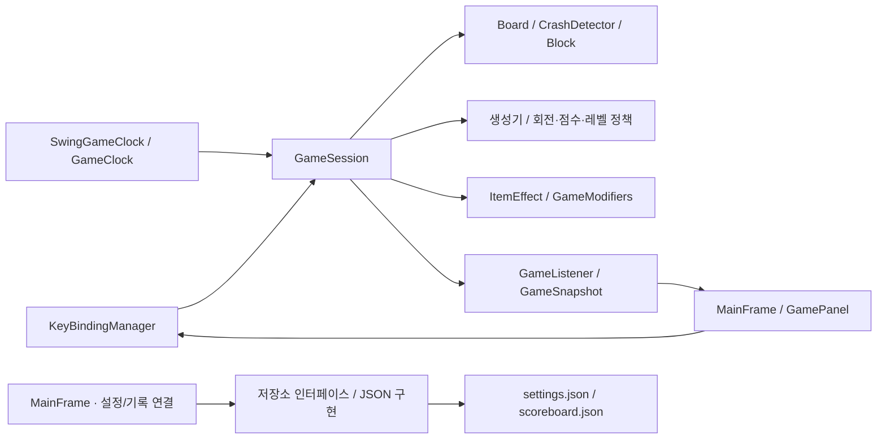

# SE Tetris · Team 6

Java 21과 Swing으로 구현한 테트리스입니다. 일반 모드의 난이도 3종과 아이템 모드, 키 설정, 분류별 스코어보드에 더해 3차 요구사항의 **로컬 2인 대전과 같은 LAN의 P2P 대전**(일반·아이템·시간제한 3모드)을 제공합니다. Windows 실행 패키지는 Java 설치 없이 실행됩니다.

**[Windows ZIP 바로 다운로드](https://github.com/yoobinkim541/SE_tetris_team6/releases/download/v0.5.0-rc.2/SE-Tetris-windows.zip)** · **[실행 JAR 다운로드](https://github.com/yoobinkim541/SE_tetris_team6/releases/download/v0.5.0-rc.2/SE-Tetris.jar)** · **[릴리스 보기](https://github.com/yoobinkim541/SE_tetris_team6/releases/tag/v0.5.0-rc.2)** · [전체 릴리스](https://github.com/yoobinkim541/SE_tetris_team6/releases)

현재 다운로드 버전은 **v0.5.0-rc.2 (요구사항 3 대전 모드 후보 2, main `c929d01`)** 입니다. 같은 릴리스의 `SHA256SUMS.txt`로 파일을 대조할 수 있습니다. rc.1 이후의 P2P 다시 대전 수정(#186), 로컬 대전 키 좌우 정렬(#187), 개발자 모드(#188)가 들어 있고, 아래 설명은 이 빌드 기준입니다(develop 전용 기능은 따로 표시). 기말평가일은 **2026-12-01**이며, 평가 빌드는 D-1(11/30)에 고정합니다([릴리스 확인표](docs/release-checklist.md)).

문서 바로가기

- 3차 대전: [요구사항·인수 기준](docs/req3/requirements.md) · [결정 기록](docs/req3/decisions.md) · [아키텍처](docs/req3/architecture.md) · [네트워크 프로토콜](docs/req3/network-protocol.md) · [대전 규칙 설명·질문 답변표](docs/req3/s12-a-rules-brief.md) · [시연 동선](docs/req3/s12-b-demo.md) · [리허설 진행표](docs/req3/s12-rehearsal-runsheet.md)
- 평가장 준비: [평가장 네트워크 안내·방화벽 스크립트](docs/req3/evaluation-network-guide.md) · [200ms 측정 절차](docs/req3/s11-lan-measurement.md)
- 2차: [요구사항 v2](docs/requirements-spec-v2.md) · [아이템 모드 명세서 — L/B/D/S/W 효과·점수·검증 화면](docs/item-specification.md) · [체크리스트 80항목 대조](docs/checklist-compliance-2026-10-27.md)
- 스프린트 기록: [Sprint 7 마감](docs/req3/s7-closeout.md) · [Sprint 8 로컬 대전](docs/sprint8-local.md) · [Sprint 8 마감](docs/sprint8-closeout.md) · [Sprint 9 B](docs/sprint9-b.md)

## 다운로드하고 실행하기

1. Windows ZIP을 다운로드하고 압축을 모두 해제합니다.
2. `SE Tetris/SE Tetris.exe`를 더블클릭합니다. Java 런타임과 아이콘이 포함되어 별도 Java 설치가 필요 없습니다.
3. 메인 메뉴에서 게임 시작(일반 모드), 아이템 모드, 대전 중 하나를 선택합니다. 일반 모드 난이도는 설정에서 변경합니다.

JAR은 Java 21 이상에서 다음과 같이 실행합니다.

```powershell
java -jar SE-Tetris.jar
```

## 주요 기능

| 기능 | 동작 |
|---|---|
| 기본 게임 | 20행 × 10열 보드, 7종 블록, 이동·회전·Soft/Hard Drop, Next 미리보기 |
| 일반 모드 | Easy / Normal / Hard에 따라 I 블록 가중치와 레벨별 낙하 속도 증가폭 조절 |
| 아이템 모드 | Normal 고정, 누적 삭제 줄 수가 10줄 경계를 넘으면 새 Next에 아이템 예약 |
| 삭제 연출 | 삭제 대상을 150ms 동안 표시한 뒤 삭제·점수·카운터·다음 Spawn 처리 |
| 세션 제어 | Pause / Resume / Restart / Quit 확인, 포커스 이탈 시 일시정지 |
| 접근성·설정 | 화면 크기 3종, 색맹 모드, 조작키 변경·중복/예약키 검증, 기본값 복원 |
| 스코어보드 | 일반 Easy / Normal / Hard와 아이템의 4분류별 Top 10, 좌우 탐색·새 기록 강조 |
| 저장 | 설정·난이도·기록 JSON 저장, 이전 파일 형식 호환과 잘못된 데이터 처리 |
| 아이템 표시 | 현재·Next 아이템 문자, 고정 D/S 문자 유지, x2·SLOW 잔여 블록과 게이지 |

### 아이템 5종

| 표시 | 효과 |
|---|---|
| L | 아이템 칸이 있는 행을 완성 여부와 관계없이 삭제 |
| B | 아이템 칸 중심 3×3 고정 칸 삭제, 칸당 10점; 행 삭제와 중복 집계하지 않음 |
| D | 획득 Lock과 이후 10 Lock의 행 보너스 2배; 재획득 시 잔여 수 갱신 |
| S | 이후 10 Spawn의 낙하 간격 1.5배; 현재 블록의 적용 간격은 Lock까지 유지 |
| W | 회전 불가 무게추; 충돌 뒤 고정 칸을 분쇄하며 하강, 분쇄 중 좌우 이동 잠금, 바닥에 값 8로 고정 |

세부 규칙·점수·화면: [요구사항 명세 v2](docs/requirements-spec-v2.md) · [지속 효과 계약](docs/item-modifier-contract.md)

### 기본 조작

| 키 | 기능 |
|---|---|
| ← / → | 좌우 이동 |
| ↓ | Soft Drop |
| ↑ | 시계 방향 회전 |
| Space | Hard Drop |
| P | 일시정지 / 재개 |
| Q | 종료 확인 |

설정에서 키를 바꾸면 게임 화면의 조작 안내에도 반영됩니다.

## 대전 모드 (요구사항 3)

메인 메뉴의 **대전**에서 로컬 일반·아이템·시간제한 대전과 **P2P 대전 (같은 LAN)** 을 고릅니다. 대전 결과는 스코어보드에 기록하지 않습니다.

| 모드 | 규칙 |
|---|---|
| 일반 대전 | 설정의 난이도로 두 보드를 동시에 진행 |
| 아이템 대전 | 2차 아이템 규칙(NORMAL)으로 진행, 점수 2배·슬로우는 얻은 사람에게만 적용 |
| 시간제한 대전 | 180초, 일반 블록, NORMAL. 시간이 끝나면 점수 비교, 동점은 무승부 |

- **공격**: 한 번에 두 줄 이상 지우면, 지운 줄에서 방금 놓은 블록 칸만 비운 회색 줄(X 무늬)이 상대 대기열로 갑니다. 상쇄는 없고, 대기열은 최대 10줄입니다.
- **삽입·패배**: 공격 줄은 상대의 줄 삭제·점수 정산이 끝나고 다음 블록이 나오기 전에 아래에 들어갑니다. 고정 칸이 보이는 보드 위로 밀리거나 새 블록을 놓을 수 없으면 패배하고, 양쪽이 같은 판정 프레임에 지면 무승부입니다.
- **일시정지**: 누가 P를 눌러도 두 보드가 함께 멈추고 함께 풀립니다. 정지 동안 시간제한 시계도 멈춥니다.

규칙 질문 답변표: [대전 규칙 설명](docs/req3/s12-a-rules-brief.md) · 결정 근거: [결정 기록](docs/req3/decisions.md)

### 대전 조작

| 화면 | 이동·Soft Drop·회전 / Hard Drop | 공통 |
|---|---|---|
| 로컬 왼쪽 보드 (P1) | A·D / S / W, F | P 일시정지, Q 나가기 |
| 로컬 오른쪽 보드 (P2) | ← → / ↓ / ↑, Space | P 일시정지, Q 나가기 |
| P2P (각자 자기 PC) | ← → / ↓ / ↑, Space | P 일시정지, Q 두 번 누르면 기권 |

대전 키는 싱글 게임의 키 설정을 덮어쓰지 않습니다.

### P2P 대전 (같은 LAN)

1. 두 PC가 같은 서브넷에 있는지 확인합니다. 호스트 PC는 인바운드 TCP **47123** 포트를 허용해야 합니다. 방화벽 전체를 끄지 말고 `scripts/firewall-rule.ps1`로 이 포트 하나만 엽니다([평가장 네트워크 안내](docs/req3/evaluation-network-guide.md)).
2. 호스트는 **P2P 대전 (같은 LAN) → 호스트로 대기**를 누르고, 화면에 나온 IP를 상대에게 알려 줍니다.
3. 클라이언트는 호스트 IP를 입력해 접속합니다. 최근에 접속에 성공한 주소 5개는 목록에서 고를 수 있습니다.
4. 대전 모드는 호스트만 고르고, 양쪽이 모두 **게임 시작**을 눌러야 경기가 시작됩니다.
5. 경기가 끝나면 결과 화면에서 Enter로 연결된 로비로 돌아가 다시 대전할 수 있습니다.

연결 상태는 heartbeat(0.5초)로 판단합니다. 왕복 200ms 초과가 3번 이어지거나 1.5초 동안 아무것도 받지 못하면 지연 안내를 띄우고, 5초 동안 받지 못하거나 상대가 연결을 끊으면 경기를 끝내고 안내합니다.

### 개발자 모드

실행 인자 `--dev`(또는 JVM 속성 `-Dtetris.dev=true`)로 켭니다. 켜지 않으면 화면과 동작은 일반 실행과 같습니다. v0.5.0-rc.2(main #188)부터 들어 있습니다.

- 창 제목에 `[개발자 모드]`가 붙습니다.
- P2P 로비 아래에 RTT 측정 패널이 붙습니다. 연결 중 heartbeat 왕복 시간을 자동으로 모으고, `RTT 200회 측정`으로 PING을 200번 따로 보냅니다. `CSV 저장`을 누르면 모은 표본을 `%APPDATA%/SETetrisTeam6/dev/rtt-<시각>.csv`에 저장합니다.
- develop 브랜치(#189)에서는 설정 화면의 `개발자: 연결 상태 표시` 항목으로도 켤 수 있습니다(기본 꺼짐). 로비와 온라인 대전 화면에 RTT·수신 빈도 등 연결 상태 줄을 표시하고, 자동 기록 표본을 최근 200개로 제한합니다. 이 변경은 아직 main에 없습니다.

이 RTT는 앱이 주고받는 PING/PONG 기준이라 양쪽 PC의 화면 처리 대기가 포함됩니다. 소켓 수준 왕복은 `NetTool`([200ms 측정 절차](docs/req3/s11-lan-measurement.md))로 따로 잽니다.

## 아키텍처

게임 규칙은 Swing에 직접 의존하지 않는 `GameSession`이 관리합니다. UI는 명령을 전달하고 세션은 `GameListener`와 복사된 `GameSnapshot`으로 상태를 전달합니다. 실제 게임은 Swing EDT에서 처리하며 테스트에서는 가짜 시계·리스너를 주입합니다.



| 경로 (`src/main/java/tetris/` 기준) | 책임 |
|---|---|
| `component/block` | 7종 블록·무게추, 모양·회전·아이템 칸 |
| `feature/game` | 세션 상태, 모드·난이도, Lock/Spawn, 스냅샷·시계 계약 |
| `feature/data`, `feature/crash` | 보드 저장·삭제·압축, 배치·충돌 판정 |
| `feature/rule` | 가중치 생성, Next 큐, Spawn·회전·Lock·점수·레벨 정책 |
| `feature/item` | L/B/D/S 효과, 삭제 대상 수집과 지속 효과 수명주기 |
| `feature/setting`, `feature/score`, `feature/save` | 설정·키 맵, 기록 분류, Jackson 기반 JSON 저장 |
| `feature/versus` | 대전 엔진(`LocalMatchEngine`): 두 세션의 판정 프레임, 공격 줄·대기열, 승패·시간제한 |
| `feature/network` | TCP 연결(`PeerConnection`), 프레임 형식, 로비(`SocketLobbyClient`), 호스트 권위 경기 동기화, heartbeat, `NetTool`·`LagProxy` 측정 도구 |
| `ui` | 메뉴·게임·설정·결과 화면, 렌더링·입력·Swing 타이머 |
| `ui/versus` | 두 보드 대전 화면, 2인 입력 분배, P2P 로비·결과 화면, 개발자 모드 패널 |

대전은 호스트 PC의 엔진 하나가 두 참가자의 결과를 정하고, 클라이언트는 입력을 보내고 상태를 받아 그립니다. 상세: [3차 아키텍처](docs/req3/architecture.md) · [네트워크 프로토콜](docs/req3/network-protocol.md)

세션 상태는 `LOADING`, `PLAYING`, `CLEARING`, `PAUSED`, `GAME_OVER`, `ENDED`입니다. Lock 시 아이템과 완성 행의 삭제 대상을 모으고, 필요한 경우 CLEARING을 거쳐 삭제·점수·효과 소비를 처리한 뒤 다음 블록을 생성합니다. 보드와 현재 블록을 분리하고 스냅샷에 사본을 제공해 화면의 변경이 원본 상태에 영향을 주지 않게 합니다.

## 요구사항 충족 현황

**기준: 2026-11-18 확인한 코드·병합 PR·이슈 기록.** '구현·자동 검증'은 프로젝트 명세 기준이며 교수자 승인이나 실제 사용자 평가 완료를 뜻하지 않습니다.

| 영역 / 규칙 | 상태 | 근거 |
|---|---|---|
| 기본 게임·조작·Lock/Spawn·점수 | 구현·자동 검증 | `src/test`, [입력·수명주기 PR #98](https://github.com/yoobinkim541/SE_tetris_team6/pull/98) |
| 난이도·가중치 생성 (DIF/GEN) | 구현·자동 검증 | [PR #83](https://github.com/yoobinkim541/SE_tetris_team6/pull/83), [#91](https://github.com/yoobinkim541/SE_tetris_team6/pull/91), [#101](https://github.com/yoobinkim541/SE_tetris_team6/pull/101) |
| 아이템 예약·5종 효과 (ITM/ITL/ITB/ITD/ITS/ITW) | 구현·자동 검증 | [PR #88](https://github.com/yoobinkim541/SE_tetris_team6/pull/88), [#95](https://github.com/yoobinkim541/SE_tetris_team6/pull/95), [효과 계약](docs/item-modifier-contract.md) |
| 메뉴·삭제 연출·표시 (MOD/ANI/RND) | 구현·자동 검증 | [PR #100](https://github.com/yoobinkim541/SE_tetris_team6/pull/100), [#106](https://github.com/yoobinkim541/SE_tetris_team6/pull/106), [#107](https://github.com/yoobinkim541/SE_tetris_team6/pull/107) |
| 설정·4분류 Top 10·JSON 호환 (SET/SBD/PER) | 구현·자동 검증 | [PR #100](https://github.com/yoobinkim541/SE_tetris_team6/pull/100), [#103](https://github.com/yoobinkim541/SE_tetris_team6/pull/103), [#104](https://github.com/yoobinkim541/SE_tetris_team6/pull/104) |
| 비기능 테스트·LINE 70% 게이트 (§14.2/14.3, CI) | 구현·CI 성공 확인 | [PR #96](https://github.com/yoobinkim541/SE_tetris_team6/pull/96): 총 240,000회 입력, 시간·불변식 검증 |
| 아이콘·JRE 포함 EXE·ZIP·JAR (DEP/CD) | 구현·릴리스 공개 | [v0.5.0-rc.2](https://github.com/yoobinkim541/SE_tetris_team6/releases/tag/v0.5.0-rc.2), [EXE 검증 기록](docs/validation-report-2026-10-26.md) |
| 로컬 2인 대전·공격·대기열·승패 (3차) | 구현·자동 검증 | [Sprint 8 로컬 대전](docs/sprint8-local.md), [경계 검증 PR #175](https://github.com/yoobinkim541/SE_tetris_team6/pull/175), [스트레스 PR #177](https://github.com/yoobinkim541/SE_tetris_team6/pull/177) |
| 3모드·P2P 로비·호스트 권위 경기 (3차) | 구현·자동 검증 | [PR #150](https://github.com/yoobinkim541/SE_tetris_team6/pull/150), [#167](https://github.com/yoobinkim541/SE_tetris_team6/pull/167) |
| 다시 대전·지연·끊김·최근 IP (3차) | 구현·자동 검증 | [PR #158](https://github.com/yoobinkim541/SE_tetris_team6/pull/158), [#167](https://github.com/yoobinkim541/SE_tetris_team6/pull/167), [#174](https://github.com/yoobinkim541/SE_tetris_team6/pull/174), [#186](https://github.com/yoobinkim541/SE_tetris_team6/pull/186) |
| 같은 LAN 입력→두 화면 200ms (3차) | 두 PC 미검증 | 단일 PC 2프로세스 600입력 최대 66.30ms([PR #183](https://github.com/yoobinkim541/SE_tetris_team6/pull/183)). 두 PC Wi-Fi heartbeat RTT p95 256.9ms로 판정 근거 부족, 유선 재측정 필요([#159](https://github.com/yoobinkim541/SE_tetris_team6/issues/159)) |
| 평가장 접속·복구 연습, 타인 플레이, 대표 선수 (3차) | 미진행 | [#161](https://github.com/yoobinkim541/SE_tetris_team6/issues/161), [#172](https://github.com/yoobinkim541/SE_tetris_team6/issues/172), [#181](https://github.com/yoobinkim541/SE_tetris_team6/issues/181) |
| 실제 사용자 2명 평가 (2차) | 미진행 기록 | [평가 기록지](docs/user-playtest.md) |
| 실제 Windows IME·OS 배율·Alt+Tab 플레이 | 수동 확인 필요 | Java UI 배율·포커스 콜백 자동 검증과 별도 |
| 시간제한 규칙·아이템 대전 공격 해석·보드 크기·제출 형식 | 교수자 확인 필요 | [결정 기록 C장](docs/req3/decisions.md), [문의·답변 기록](docs/professor-confirmation.md) |

### 검증 기록

| 검증 | 기준 | 결과 |
|---|---|---|
| test + JaCoCo | develop `2cacf1c` (2026-11-18 로컬) | 1,274개 / 실패 0 / 생략 21, LINE 88.28% (5,326 / 6,033) |
| 평가 번들 (`scripts/build-eval-bundle.ps1`) | main `60562eb` (2026-11-16, [#162](https://github.com/yoobinkim541/SE_tetris_team6/issues/162)) | check·guiAcceptance·packageApp 성공, 1,237개 / 실패 0, LINE 88.31% |
| Package 워크플로 (v0.5.0-rc.2) | main `c929d01` (#191) | check·guiAcceptance·packageApp·EXE 실행 성공, 1,242개 / 실패 0 / 생략 21, LINE 88.16% |

2차 시점의 전체 인수 기록(requirementsAudit 71건, Java UI 배율 100/150/200%)은 [2026-10-26 보고서](docs/validation-report-2026-10-26.md)에 있습니다. 사용자 평가·교수자 확인은 위 표의 미진행 상태를 유지합니다.

## 개발·빌드·배포

개발·빌드는 JDK 21 이상이 필요합니다. Windows EXE 패키징과 실제 창 인수 검증은 Windows에서 실행합니다. Gradle Wrapper 첫 실행에는 배포본·의존성 다운로드를 위한 네트워크 연결이 필요합니다.

| 목적 | Windows 명령 | 결과 |
|---|---|---|
| 개발 실행 | `.\gradlew.bat run` | 게임 창 |
| 실행 도우미 | `.\run.bat` | 기존 빌드 EXE 실행, 없으면 Gradle 실행 |
| 테스트·커버리지 | `.\gradlew.bat check` | 테스트와 LINE ≥ 70% 게이트 |
| 실제 창 검증 | `.\gradlew.bat guiAcceptance` | JFrame 기반 검증 |
| 실행 JAR | `.\gradlew.bat releaseJar` | `build/libs/SE-Tetris.jar` |
| Windows 패키지 | `.\gradlew.bat packageApp` | `build/distributions/SE-Tetris-windows.zip` |
| EXE 실행 검증 | `.\scripts\verify-package.ps1` | `build/verification/package-smoke.json` |

전체 인수 검증 재현:

```powershell
.\gradlew.bat test check guiAcceptance releaseJar packageApp -I audit/requirements-audit.init.gradle requirementsAudit -PauditGui=true --no-daemon
.\gradlew.bat guiAcceptance '-PguiScale=1.5' --no-daemon
.\gradlew.bat guiAcceptance '-PguiScale=2.0' --no-daemon
.\scripts\verify-package.ps1
```

CI는 Linux 테스트·커버리지와 Windows 인수·패키징·EXE 실행을 검증합니다. [Package 워크플로](.github/workflows/package.yml)는 main push·`v*` 태그·수동 실행을 지원하며 태그 빌드에서 ZIP/JAR을 Release에 첨부합니다.

### 사용자 데이터

Windows 저장 위치는 `%APPDATA%/SETetrisTeam6/`입니다.

- `settings.json`: 화면 크기, 색맹 모드, 조작키, 난이도 (develop은 `devNetworkOverlay` 추가)
- `scoreboard.json`: 모드·난이도별 기록
- `recent-peers.json`: P2P 접속에 성공한 최근 주소 5개
- `dev/rtt-<시각>.csv`: 개발자 모드에서 저장한 RTT 표본

이전 형식·손상 처리 규칙: [명세 v1.2](docs/requirements-spec-v1.2.md) · [명세 v2](docs/requirements-spec-v2.md)

## 협업·문서

팀원: 김유빈 · 심재윤 · 심규민

feature/fix 브랜치에서 develop으로 PR을 만들고 팀원 리뷰 후 병합합니다. main은 제품 배포용이며 직접 커밋하지 않습니다. 커밋은 `Feat`, `Fix`, `Docs`, `Style`, `Refactor` 타입과 변경 요약을 사용합니다.

- [요구사항 v2 · 아이템 화면](docs/requirements-spec-v2.md)
- [감사 기록](docs/requirements-audit-2026-10-26.md) · [인수 검증 안내](audit/README.md)
- [검증 보고서](docs/validation-report-2026-10-26.md) · [릴리스 확인표](docs/release-checklist.md)
- [사용자 평가](docs/user-playtest.md) · [교수자 문의](docs/professor-confirmation.md)
- [Notion 프로젝트](https://app.notion.com/p/Software-Enginering-Term-Project-Tetris-3e1a13e7df00802e96f8fe312fa590ea)
