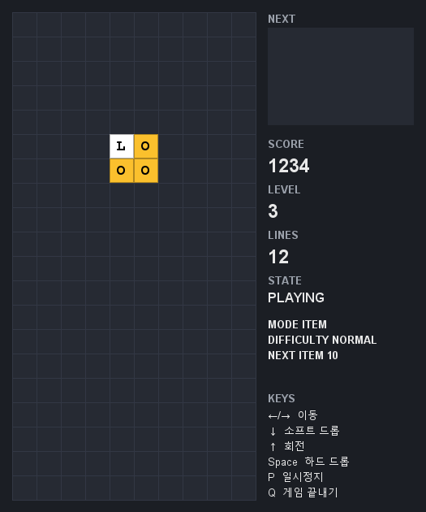
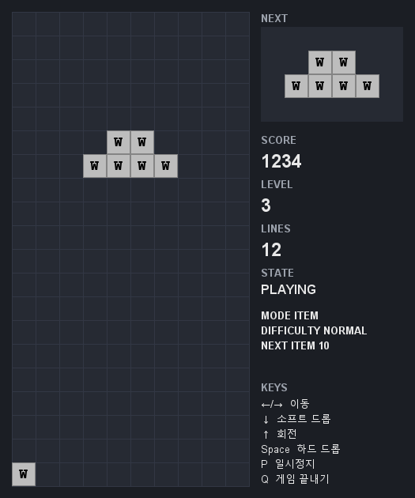
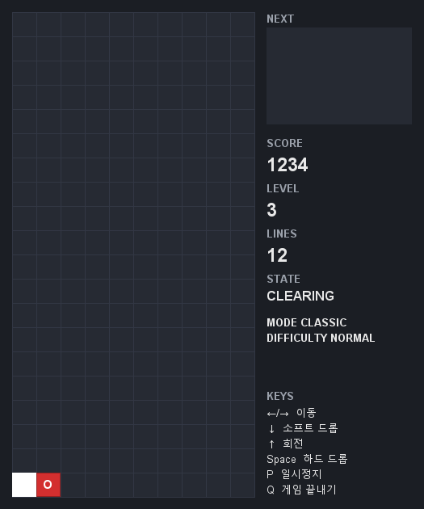

# 아이템 모드 명세서

SE Tetris · Team 6 / 김유빈 · 심재윤 · 심규민  
작성일: 2026-10-27 / 버전: 1.0  
기준: `develop`의 아이템 구현. 일반 게임 규칙은 [요구사항 v2](requirements-spec-v2.md), 개발용 API 계약은 [아이템 효과 계약](item-modifier-contract.md)을 따른다.

이 문서는 현재 구현을 설명하는 평가·플레이용 명세다. 교수자 승인 또는 실제 사용자 평가 결과를 의미하지 않는다. 첨부 이미지는 실제 `GamePanel`에 결정적인 상태를 넣어 생성한 **렌더링 검증 화면**이며, 실제 플레이를 촬영한 화면과 구분한다.

## 1. 모드와 생성 규칙

| 항목 | 규칙 |
|---|---|
| 시작 | 메인 메뉴의 아이템 모드 선택 |
| 난이도 | 설정값과 무관하게 NORMAL 고정 |
| 보드 | 보이는 영역 20행 × 10열, 위쪽 숨은 2행 |
| 일반 블록 | I·J·L·O·S·T·Z 7종 균등 선택 |
| 생성 시점 | 누적 삭제 줄 수가 10줄 경계를 넘으면 새 NEXT 블록 1개를 아이템으로 예약 |
| 예약 판정 | `floor(새 누적 줄 / 10) > floor(이전 누적 줄 / 10)` |
| NEXT 순서 | 이미 보이던 NEXT는 그대로 다음 현재 블록이 되고, 새로 채워지는 NEXT가 아이템이 됨 |
| 종류 선택 | 행 삭제 L·폭탄 B·점수 2배 D·슬로우 S·무게추 W 각각 20% |
| 부착 위치 | L/B/D/S는 일반 블록의 채워진 4칸 중 1칸을 균등 선택해 부착; 회전·복사 시 위치 정보 유지 |
| 무게추 | 일반 블록에 붙는 문자가 아니라 블록 전체가 특수 모양인 아이템 |
| 누적에 포함 | 자연 완성 행과 L로 삭제한 행 |
| 누적에서 제외 | B로 지운 개별 칸, W가 분쇄한 칸 |

예: 누적 9줄에서 4줄을 지워 13줄이 되면 아이템 1개를 예약한다. 누적 10줄이면 NEXT ITEM은 다음 20줄까지 남은 10줄을 표시한다. 일반 모드에서는 아이템을 예약하지 않는다.

## 2. 표시와 조작

L/B/D/S 칸은 **흰 바탕·검은 굵은 문자**, W는 **연회색·W**로 표시한다. 색맹 모드에서도 아이템 문자와 표시 원칙은 유지한다. 현재 블록과 NEXT 모두 아이템을 표시하며, 고정된 D/S 칸의 문자는 해당 칸이 삭제·분쇄되거나 초기화될 때까지 남는다. 고정 문자는 효과를 다시 발동시키지 않는다.

기본 키는 ←/→ 이동, ↑ 회전, ↓ Soft Drop, Space Hard Drop, P Pause/Resume, Q 종료 확인이다. 사용자 지정 조작키도 동일하게 적용한다. W의 회전 입력과 분쇄 중 좌우 이동은 무시한다.

| 정보 영역 | 의미 |
|---|---|
| MODE / DIFFICULTY | 아이템 모드 / NORMAL |
| NEXT ITEM | 다음 10줄 경계까지 남은 줄 수 (`10 - 누적 줄 % 10`) |
| x2 | 앞으로 적용할 D 효과의 잔여 Lock 수 |
| SLOW | 현재 블록 **이후** 추가로 느려질 Spawn 수 |
| 효과 게이지 | 남은 블록 수를 10칸 게이지로 표시; 작은 화면은 간략 텍스트 사용 |

## 3. 아이템별 명세

### 3.1 L — 행 삭제

규칙: ITL-1~4.

- L이 붙은 블록이 고정되면 **L 칸이 있는 행 전체**를 완성 여부와 관계없이 삭제한다.
- 자연 완성 행과 L 행은 합쳐서 처리한다. 같은 행이면 한 번만 삭제·집계한다.
- 행 삭제 후 위 행이 내려오며, 삭제 행 수는 누적 줄·레벨·다음 아이템 예약 판정에 포함한다.
- 행 점수는 삭제한 행 수의 보너스를 한 번 적용하며 D가 켜져 있으면 2배다.
- 숨은 행의 L도 삭제 대상으로 수집한다. 화면에는 보이는 행의 삭제 대상만 표시한다.



### 3.2 B — 폭탄

규칙: ITB-1~4.

- B가 붙은 블록이 고정되면 **B 칸을 중심으로 한 3×3** 영역의 실제 채워진 칸을 삭제한다. 고정 직후이므로 B 자신의 칸도 대상이다.
- 보드 밖은 제외하고 숨은 2행은 범위에 포함한다. 벽 근처에서는 유효 범위만 적용한다.
- 이번 Lock의 삭제 행에 속한 칸은 개별 칸 삭제에서 제외한다. 같은 칸에 행 점수와 칸 점수를 중복 지급하지 않는다.
- 개별 칸 삭제만으로는 위 칸이 내려오지 않는다. 같은 Lock에서 행도 지우면 개별 칸을 먼저 삭제한 후 행을 압축한다.
- 실제로 지운 개별 칸당 **10점**이다. 레벨과 D의 점수 배율을 적용하지 않는다.
- B의 개별 칸 삭제 수는 누적 삭제 줄 수에 더하지 않는다.


### 3.3 D — 점수 2배

규칙: ITD-1~6.

- D가 붙은 블록이 고정된 **이번 Lock부터** 행 삭제 보너스가 2배다.
- 획득 Lock 이후 **추가 10 Lock**까지 적용하므로 재획득이 없다면 총 11 Lock이 적용 대상이다.
- 획득 Lock 종료 시 잔여 수는 10이다. 이후 Lock마다 한 번 감소하며, 삭제 행이 없는 Lock도 소비한다.
- 재획득하면 잔여 수를 10으로 갱신한다. 4배로 중첩하거나 기간을 더하지 않는다.
- 자동 낙하·Soft/Hard Drop 점수와 B의 칸당 10점에는 적용하지 않는다.
- S 효과와 독립적으로 유지·갱신·만료한다.


### 3.4 S — 슬로우

규칙: ITS-1~6.

- S가 붙은 블록이 고정된 후 **다음 성공한 Spawn 10개**의 자동 낙하 간격을 1.5배로 한다. 예: 1,000ms → 1,500ms.
- 획득한 블록 자신의 낙하 간격은 소급해서 바꾸지 않는다.
- Spawn 시 대상 여부를 정하고 잔여 수를 1 줄인다. 그 블록의 간격은 Lock까지 유지한다.
- 화면의 SLOW는 현재 블록 이후 남은 Spawn 수다. 첫 대상 블록에서 9, 열 번째 대상 블록에서 0을 표시하되 **현재 블록에는 계속 적용**한다. 다음 Spawn부터 해제한다.
- 재획득하면 앞으로 적용할 Spawn 수를 10으로 갱신한다. 배율을 곱해서 중첩하지 않는다.
- Spawn 충돌로 게임이 끝난 경우 잔여 수를 소비하지 않는다. Pause/Resume도 소비하지 않으며 현재 블록의 간격을 보존한다.


### 3.5 W — 무게추

규칙: ITW-1~8, ARC-3.

너비 4칸·높이 2칸의 6칸 모양이며 회전하지 않는다. 아래 그림의 점은 빈칸이다.

```text
.WW.
WWWW
```

- Spawn 앵커는 논리 좌표 `(행 0, 열 3)`이다. Spawn 위치가 막혀 있으면 분쇄하지 않고 Game Over가 된다.
- 충돌 전에는 좌우 이동이 가능하다.
- 고정 칸 때문에 처음 하강에 실패하는 순간 분쇄 상태로 전환한다. 그 순간부터 한 칸 내려가며 겹치는 고정 칸을 제거한다.
- 분쇄 상태에서는 좌우 이동을 무시한다. 하강할 때마다 겹치는 고정 칸을 지우며 위 칸을 아래로 당기지 않는다.
- 바닥·벽은 분쇄하지 않는다. 바닥에서 더 내려갈 수 없으면 값 8로 고정한다.
- Hard Drop은 즉시 바닥까지 분쇄하며 이동한 뒤 고정한다.
- W의 자동 낙하·Soft/Hard Drop·분쇄 칸 점수는 **0점**이다. 고정 결과 행이 완성되면 일반 행 삭제 보너스는 적용하며, D가 켜져 있으면 해당 행 보너스는 2배다.
- 분쇄 자체에는 150ms 흰색 삭제 연출을 넣지 않는다. 고정 후 완성 행이 있으면 일반 CLEARING을 적용한다.



## 4. 삭제·점수·효과 처리 순서

1. 현재 블록을 보드에 고정한다.
2. 아이템을 발동하고 자연 완성 행·아이템 삭제 행·개별 삭제 칸을 수집한다. 중복 행과 행에 속한 개별 칸을 제거한다.
3. 삭제 대상이 있으면 150ms CLEARING 상태로 표시한다. 이동·회전·드롭을 무시하며, 삭제 대상이 없으면 이 단계를 생략한다.
4. 개별 칸을 비운 뒤 행을 삭제·압축한다.
5. 행 보너스와 실제 개별 칸 삭제 점수를 지급한다.
6. 누적 줄·레벨·다음 아이템 예약을 갱신하고 D의 Lock 수명을 처리한다.
7. 다음 블록을 Spawn한다. 성공 시 S 대상 여부와 잔여 수, 낙하 타이머를 갱신한다.

| 한 번에 삭제한 행 수 | 0 | 1 | 2 | 3 | 4 |
|---|---:|---:|---:|---:|---:|
| 행 보너스 | 0 | 100 | 300 | 500 | 800 |

```text
Lock 삭제 점수 = 행 보너스(중복 없는 삭제 행 수) × D 배율(1 또는 2)
              + 실제 개별 삭제 칸 수 × 10
```

행 보너스에는 레벨을 곱하지 않는다. 일반 블록의 하강 점수는 별도로 이동 칸 수 × 당시 레벨이며 D의 대상이 아니다. 예를 들어 하강 점수 22점, 2행 삭제, D 적용, 행과 중복하지 않는 B 삭제 4칸이면 `22 + 300×2 + 4×10 = 662점`이다. 이는 점수 항목의 조합 계산 예시이며 한 블록에 B와 D가 함께 부착된다는 뜻이 아니다.

CLEARING 중 Pause하면 삭제와 효과 소비를 보류한다. Resume 시 150ms를 처음부터 다시 센다. Restart는 누적 줄·아이템 예약·D/S·분쇄 상태를 초기화한다. 메뉴로 종료하면 해당 세션을 폐기한다.



## 5. 테스트와 평가 확인표

아래 테스트 파일은 `src/test/java/tetris/feature/`에 있으며, 화면 테스트는 `src/test/java/tetris/ui/`에 있다.

| 확인 항목 | 자동 검증 근거 |
|---|---|
| 5종 각 20%, 요청 한 번 소비, 예외 시 요청 보존 | `ItemBlockGeneratorTest` |
| 10줄 경계·기존 NEXT 보존·일반 모드 제외·Restart | `ItemPendingTest` |
| 부착 위치 균등·회전·사본 격리 | `BlockTest`, `ItemSnapshotTest` |
| L 행 반환·중복 삭제 방지·숨은 행 | `LineClearItemTest`, `ItemEffectHookTest` |
| B 범위·벽·숨은 행·중복 점수 방지 | `BombItemTest` |
| D 획득+10 Lock·재획득·행 점수만 배율 | `DoubleScoreItemTest`, `GameModifiersLifecycleTest` |
| S 10 Spawn·잔여 0의 현재 블록·재획득·Pause | `SlowItemTest`, `ModifierSessionTest` |
| W 모양·회전 불가·분쇄·좌우 잠금·점수·Spawn 충돌 | `WeightBlockTest`, `WeightCrushTest` |
| 150ms·입력 정지·Pause/Resume·삭제 없는 Lock | `ClearingAnimationTest` |
| 고정 D/S 문자 보존·행 이동·분쇄 시 제거 | `LockedItemMarkTest`, `LockedItemRenderingTest` |
| 효과 표시·작은 화면·게이지 | `EffectsPanelTest` |
| 전체 5종을 실제 Lock 경로로 실행·보드 불변식 | `RandomInputStressTest` |

Windows / JDK 21 이상에서 실행한다.

```powershell
.\gradlew.bat test check --no-daemon
.\gradlew.bat guiAcceptance --no-daemon
```

기본 테스트는 headless이며 실제 창 검증은 `guiAcceptance`로 별도 실행한다. 자동 검증 결과와 실제 사용자 2명 플레이 평가는 구분한다. 검증 이력은 [검증 보고서](validation-report-2026-10-26.md), 실제 평가 기록은 [사용자 평가 기록지](user-playtest.md)에 남긴다.

## 6. 구현 근거

| 책임 | 구현 |
|---|---|
| 예약·Lock/Spawn·삭제·점수 | `GameSession`, `Board`, `ScoringPolicy` |
| 5종 선택·블록 부착 | `ItemBlockGenerator`, `Block` |
| 아이템 효과 | `LineClearEffect`, `BombEffect`, `DoubleScoreEffect`, `SlowEffect` |
| 지속 효과 상태 | `GameModifiers` — 세션별 상태, D와 S 독립 관리 |
| 무게추 | `WeightBlock`, `GameSession`의 무게추 하강 경로 |
| 표시 | `GameSnapshot`, `GamePanel`, `BlockPalette` |

아이템이 고정된 뒤 자동으로 다른 아이템을 연쇄 발동시키는 기능은 없다. B·W가 기존 아이템 표시 칸을 지워도 그 칸의 효과를 다시 발동시키지 않는다. 아이템 모드의 추가 난이도와 V 아이템은 현재 구현 범위에 포함하지 않는다.
