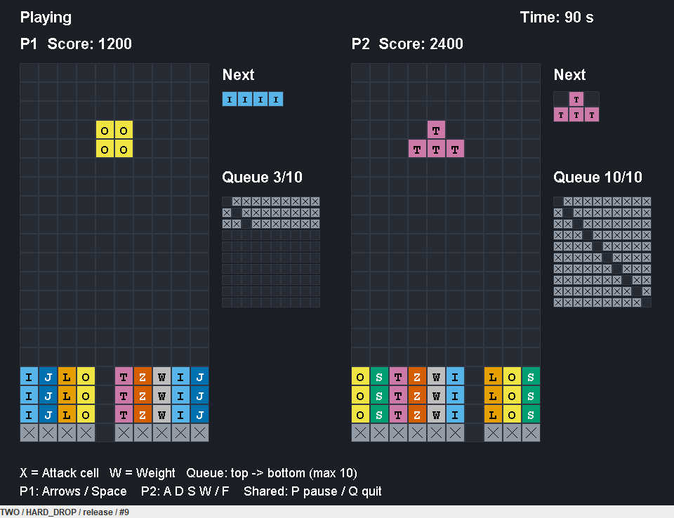

# Sprint 7 마감·인수·대리 KPT

2026-11-08. 기준 `develop` 5b97b4b에서 시작했다. 사용자가 남은 작업 전부와 리뷰·시연·회고를 AI에 위임했다. 검토·시연·회고 작성자는 AI이며, 사람 팀원이 참석하거나 승인했다고 기록하지 않는다.

## 완료 산출물

| 작업 | 구현·인수 근거 |
|---|---|
| S7-A1 (#114) | 공통 API v1, DueTimeClock, SpawnBoundary. B 임시 DTO 제거 및 공통 API 직접 소비, C LobbyClient 계약. BattleCommonApiTest/CommonWireContractTest/LobbyContractTest |
| S7-A2 (#115) | AttackRowExtractor/PendingAttackQueue. 삭제 전 사본에서 Lock 블록 점유 칸 제거·기존 구멍 보존·회색 값 9 정규화. 최종 보이는 행 합집합이 2줄 이상일 때만 공격. GameSession 정산 후 1회 발행 |
| S7-B1 (#116) | 두 보드·Next·점수·10줄 큐·작은 창·색맹 구분. 공통 MatchSnapshot.PlayerView 소비 |
| S7-B2 (#117) | 루트 하나에서 P1/P2 분리·공통 Pause/Quit·반복·modifier release·포커스 해제. 공통 PlayerCommand/BattleClient 소비 |
| S7-C1 (#118) | 기존 기준선과 64KiB 길이 접두 JSON·오류 정책. 공통 CONFIG/INPUT/STATE 프레임 소비 검증. 로비 상태·설정 revision/READY 계약 보완 |
| S7-C2 (#119) | 실제 TCP·두 JVM loopback·부분/합친 수신·종료·자원 회수. 초기 RTT와 두 PC 200ms 인수 구분 |

## A2 경계 인수

- 회전한 I/L의 모든 점유 칸과 원래 빈칸을 구분해 복사한다. 행은 위→아래로 정렬·중복 제거하고 숨은 행은 공격에서 제외한다.
- L 아이템의 불완전 삭제 행을 자연 완성 행과 합친다. B/W의 칸 삭제를 행 수에 더하지 않는다.
- CLEARING 시작에는 공격하지 않는다. Pause/Resume·150ms 삭제 종료 후 정산 시 정확히 한 번 발행한다. end/restart는 미발행 사본을 폐기한다.
- 기존 8 + 신규 3이면 신규의 앞 2줄만 받는다. 이미 10이면 추가는 무시한다. drain은 한 번만 반환하며 조회/입력 배열은 격리한다.
- 선택적 deferred Spawn은 타이머를 멈추고 null 블록 입력/tick을 무시한다. 엔진이 명시적으로 resumeSpawn한다. inline resume/end 재진입도 검증한다.
- 기존 생성자는 SpawnBoundary.IMMEDIATE 경로를 유지한다. 기존 점수 감사가 내부 ClearPlan 생성자를 사용하므로 2인수 호환 생성자도 유지했다.

## 대리 리뷰와 시연

서로 다른 AI 작업자가 B UI와 C 로비 계약을 구현했고, 별도 읽기 전용 AI 검토자가 변경 파일과 새 파일을 검토했다. READY revision 0 허용 문제를 실패 테스트로 재현한 뒤 수정했다. 재리뷰에서 남은 중요 지적은 없었다.

사용자가 실제 팀원 리뷰 대신 AI 대리 수행을 명시적으로 요청했다. 따라서 위 검토를 이번 S7 인수 근거로 사용한다. 사람 팀원의 형식적 GitHub APPROVE를 제출하거나 제출됐다고 기록하지 않는다.

시연 절차는 독립 Fake Swing 창에서 P1 이동 → P2 이동 → 공통 Pause → 정지 중 이동 무시 → Resume → P2 Hard Drop 명령 → Quit이다. OS 키보드 입력이 아니라 실제 루트 ActionMap 경로를 호출해 검증한다. 블록 시뮬레이션은 하지 않는 Fake 시연이다.

```powershell
.\gradlew.bat test --tests 'tetris.versus.ui.BattleDemoAcceptanceTest' --tests 'tetris.versus.ui.BattleLifecycleTest' -I docs/sprint7-b-gui.init.gradle
```

시연 산출물: `build/reports/sprint7-demo.png`. 일반 렌더링: `build/reports/sprint7-b-preview.png`.



## 검증 결과

Windows / JDK 21.0.12.1. 최종 실행 결과는 아래에 기록한다.

- 기본 회귀: 988개, 실패 0, GUI opt-in 11개 생략. check 및 70% 커버리지 게이트 통과.
- LINE: 2623 / 2902 = 90.4%.
- guiAcceptance: 9/9 통과.
- resourceAcceptance: 최초 전체 실행에서 CLASSIC EDT 정리 대기(5초) 타임아웃 1건. 임계값·테스트를 완화하지 않고 단독 재실행하여 23/23 통과. 실제 기기 전체 사양 인증과 구분한다.
- 기본 check 재실행에서도 기존 ChecklistInputLatencyTest의 CLASSIC 입력 대기(1초) 타임아웃이 한 번 관찰됐다. 동일 임계값의 단독 테스트는 통과했다. 간헐적인 로컬 EDT 지연 관찰로 남기며, 환경 원인이라고 확정하거나 실패를 숨기지 않는다.
- 대리 시연·포커스 수명: 네이티브 창에서 2/2 통과. 생성 PNG를 직접 확인했다.

## KPT (AI 대리 회고)

| 구분 | 실제 관찰과 후속 행동 |
|---|---|
| Keep | 작은 기능 커밋, 실패→수정→재검증, 독립 코드 리뷰를 유지한다. 공유 DTO를 직접 소비하는 테스트가 계약 차이를 조기에 드러냈다. |
| Problem | A2가 계약 DTO만 있는 상태로 남았고 Notion/GitHub 상태가 실제 develop 반영과 달랐다. B 임시 DTO 중복과 READY revision 0 허용도 발견했다. 전체 자원 실행에서는 EDT 정리 타임아웃이 한 번 발생했다. |
| Try | 다음 스프린트 첫 세션에 계약 소비 테스트와 기준 CI를 먼저 실행한다. develop 머지 후 이슈·Notion·검증 링크를 같은 작업에서 갱신한다. 네이티브/자원 테스트는 단독 재현 로그를 남기고 실패를 숨기지 않는다. |

위 회고는 코드·테스트 기록으로 작성했으며 실제 팀 회의나 개인의 의견을 만들어 넣지 않았다. 실제 소요 시간은 측정하지 않았으므로 계획 시간이나 Story Point를 실적으로 채우지 않는다.

## S8 이후 인계와 제한

S7 미완료 기능을 숨겨 이월한 항목은 없다. 원래 S8 이후 범위는 다음과 같다.

- 공격 행의 실제 Board 삽입·상단 초과, 두 GameSession을 소유하는 MatchEngine, 로컬 BattleClient.
- 실제 소켓 로비의 host/connect/cancel·준비 핸드셰이크, 로비 화면과 메뉴 연결.
- 경기 전송용 DTO 변환·권위/이전 matchId 거절·30Hz 상태 합치기·heartbeat·단절 회복.
- 두 PC LAN 입력→양쪽 화면 200ms, 느린 네트워크 실측, 원래 남아 있던 실제 장비 평가.

원래 A2/C2의 S8 첫 세션 0.5h 배정은 S7 구현 인수를 이번에 끝냈으므로 구현 미완료 시간으로 다시 기재하지 않는다. 실제 시간 사용량을 0.5h로 계산했다는 뜻은 아니다.
